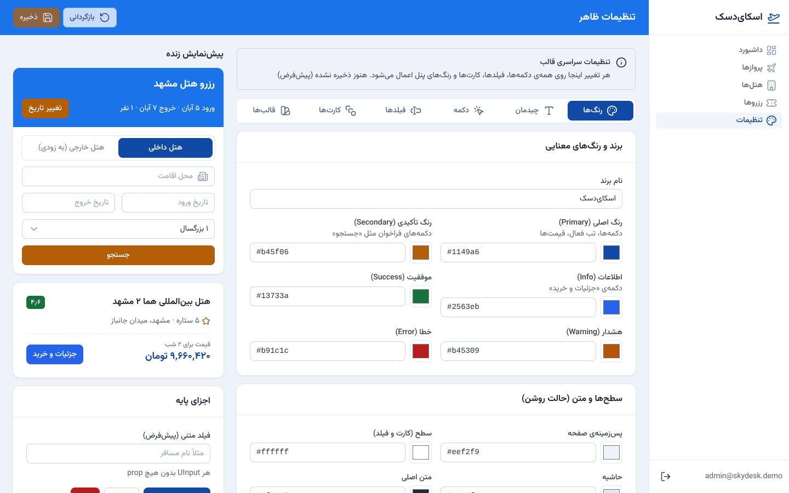
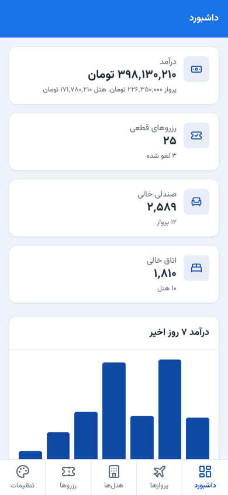
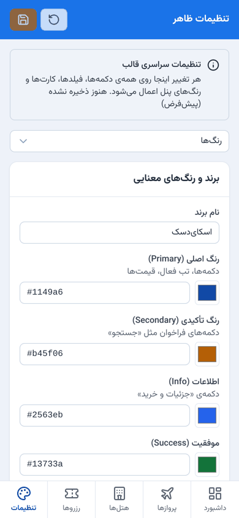
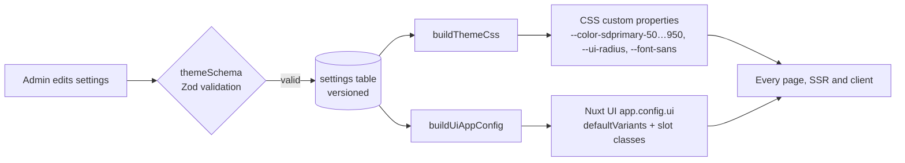

# SkyDesk Admin

**English** | [فارسی](README.fa.md)

[](https://github.com/imndst/skydesk-admin/actions/workflows/ci.yml)


[](LICENSE)

An admin panel for selling **flight tickets** and **hotel stays**, built as a single full-stack Nuxt app.
Its main feature is an **admin-configurable theme system**: design tokens and Nuxt UI component defaults
(button, field, card, badge, tabs, modal) are edited in the UI, previewed live, and applied across every page
without a single styling prop in page code.

Persian (RTL) interface · prices in Toman · Jalali dates · works on desktop and mobile.

<p align="center">
  
</p>

<p align="center">
  
  
  
</p>

## Contents

- [Features](#features)
- [Quick start](#quick-start)
- [Theme system](#theme-system)
- [Architecture](#architecture)
- [Security](#security)
- [Testing](#testing)
- [Performance](#performance)
- [Tech choices and trade-offs](#tech-choices-and-trade-offs)
- [Limitations and roadmap](#limitations-and-roadmap)

## Features

**Sales back office**
- Dashboard: revenue (total, flights, hotels), confirmed and cancelled bookings, free seats and rooms, 7-day revenue chart, latest bookings.
- Flights and hotels: search, sort, paginate, create, edit, delete (delete is blocked when bookings exist).
- Bookings: sell a flight or a hotel stay, cancel (seats and rooms are released). The total is always computed on the server.
- Inventory is updated inside SQL transactions, so overbooking is impossible even under concurrent requests.

**Theme settings** (`/settings`)
- Colors: 6 semantic colors plus page, surface, border, text, muted text and header. Full 50–950 shade scales are generated from each hex.
- Typography and layout: font (self-hosted Vazirmatn or system), global UI scale, global radius, light/dark/system mode, header style.
- Component defaults: button, form fields (`UInput`, `UInputNumber`, `USelect`, `USelectMenu`, `UTextarea`, `UFormField`), card, badge, tabs, modal.
- Live preview across the whole app, unsaved-change guard, version-checked saves (two admins cannot overwrite each other).
- Live WCAG contrast report for every color pair.
- 5 presets, export as [W3C Design Tokens](https://design-tokens.github.io/community-group/format/) (Figma / Tokens Studio), settings backup and restore.

**UX**
- Responsive: semantic tables on desktop, stacked cards and a bottom tab bar on mobile, no horizontal page scroll.
- No overlapping layers: every app layout is flex/grid in normal flow (checked by an automated geometry test).
- Shared Zod schemas validate on both client and server; server errors are mapped back onto the right field.
- Persian keyboard digits are accepted in numeric fields.

## Quick start

Requirements: **Node.js 20.18 or newer** (tested on 20.18.2, 22 and 24).

```bash
git clone https://github.com/imndst/skydesk-admin.git
cd skydesk-admin
npm ci
npm run dev        # http://localhost:3000
```

Sign in with **admin@skydesk.demo** / **Admin#2026demo**.
The SQLite database is created and seeded on first run (`data/skydesk.db`; delete it to reset).

| Script | What it does |
|---|---|
| `npm run dev` | Development server with HMR |
| `npm run build` | Production build into `.output/` |
| `npm run start:demo` | Run the production build over plain http on localhost (works on Windows too) |
| `npm start` | Run the production build behind HTTPS (`Secure` cookies) |
| `npm test` | Build, then run API, security, theme and performance tests |
| `npm run test:only` | Same tests without rebuilding |
| `npm run test:e2e` | Build, then run Playwright browser tests on 5 viewports |

Configuration is optional; see [`.env.example`](.env.example). Set a 32+ character `SESSION_SECRET` in production.

## Theme system

Pages never style components. They only pass *meaning*:

```vue
<UButton label="Save" />                                    <!-- color, size, radius, weight, shadow: from settings -->
<UButton color="error" label="Delete" />                    <!-- destructive -->
<UButton color="neutral" variant="outline" label="Cancel" /><!-- secondary action -->
<UButton color="secondary" label="Search" />                <!-- call to action -->
```



- **Two outputs, one source.** `shared/theme.ts` turns the validated settings into CSS variables (colors, radius, font, scale) and into Nuxt UI's `app.config` (default color, variant and size, plus slot classes for radius, weight and shadow).
- **No flash.** The plugin reads the theme during SSR, so the first paint is already themed. On the client the same state drives live updates.
- **Injection-proof by construction.** Only validated `#rrggbb` hex values and values looked up from fixed maps ever reach CSS or class names; unknown keys are stripped.
- **Forward compatible.** Stored settings are deep-merged with the defaults, so adding a new setting never breaks old data.

Details: [docs/THEMING.md](docs/THEMING.md).

## Architecture

```
app/                     Frontend (Vue 3 + Nuxt UI)
  pages/                 dashboard, flights, hotels, bookings, settings, login
  components/            AppPage, BottomNav, ResponsiveTable, form modals, ThemePreview, ColorField, ContrastReport
  plugins/theme.ts       applies the theme in SSR and in the browser
server/                  Backend (Nitro)
  api/                   REST endpoints
  middleware/guard.ts    rate limit, CSRF check, authentication
  utils/                 SQLite access, auth, validation helpers, theme storage
shared/                  Code used by both sides
  schemas.ts             Zod schemas (Persian messages)
  theme.ts               design tokens, presets, theme → CSS and Nuxt UI config
tests/                   Vitest: API, security, theme, performance (against the real built server)
e2e/                     Playwright: layout, accessibility, forms, theme flow
```

The API is a small REST surface: `/api/auth/*`, `/api/flights`, `/api/hotels`, `/api/bookings`, `/api/dashboard`, `/api/theme`.

## Security

| Threat | Mitigation |
|---|---|
| SQL injection | Prepared statements only; static SQL text; `sort` through an allow-list; `LIKE` wildcards escaped; integer-only ids; CHECK and FK constraints in the schema |
| XSS | Input rejects `<`, `>` and control characters; `xssValidator`; Vue output escaping (no `v-html`); nonce-based CSP with `strict-dynamic` |
| CSS / class injection (theme) | Hex-only colors, enum-only options mapped through fixed tables, unknown keys stripped |
| Mass assignment, price tampering | Bodies parsed by Zod (extra fields dropped); totals computed server-side |
| CSRF | `HttpOnly` + `SameSite=Strict` cookie, required custom header, `Origin` check |
| Authentication | scrypt password hashes, HMAC-SHA256 signed sessions, timing-safe comparisons, identical error for unknown user and wrong password |
| Brute force / abuse | 5 failed logins → 429 for 15 min; 600 requests/min per IP; 20 KB body limit |
| Headers | CSP, HSTS, X-Frame-Options, nosniff, Referrer-Policy, Permissions-Policy; no CORS |
| Information leaks | No stack traces or file paths in API errors |

Each row is covered by tests in `tests/security.test.ts` and `tests/theme.test.ts`. See [SECURITY.md](SECURITY.md) to report a vulnerability.

## Testing

| Suite | What it checks |
|---|---|
| `tests/api.test.ts` | CRUD, booking lifecycle, inventory, validation of every field, pagination, filters |
| `tests/security.test.ts` | SQL injection payloads, XSS payloads, CSRF, forged sessions, brute force, rate limit, body size, headers |
| `tests/theme.test.ts` | theme → CSS/config mapping, presets, CSS injection, version conflicts, SSR output |
| `tests/perf.test.ts` | p95 latency budget per endpoint (see below) |
| `e2e/*.spec.ts` | 12 scenarios × 5 viewports (1440, 1024, 768, 390, 360): no overlap, no horizontal scroll, axe WCAG 2 A/AA, forms, theme flow |

80 Vitest tests and 60 Playwright runs, all passing on Node 20.18.2. The Vitest suites start the real production build and talk to it over HTTP; nothing is mocked.

```bash
npm test
npx playwright install chromium && npm run test:e2e
```

## Performance

Budget: **p95 < 10 ms per API request**. Measured over 300 sequential requests per endpoint on the production build (loopback, Node 20.18.2):

| Endpoint | Server p95 | Round-trip p95 |
|---|---|---|
| `GET /api/dashboard` | 0.40 ms | 2.0 ms |
| `GET /api/flights` (search + sort) | 0.41 ms | 1.1 ms |
| `GET /api/hotels` | 0.39 ms | 1.0 ms |
| `GET /api/bookings` (filtered) | 0.73 ms | 1.6 ms |
| `POST /api/bookings` (transaction) | — | 1.2 ms |

Every response carries a `Server-Timing` header. CI runs the same test with a relaxed 25 ms budget, because shared GitHub runners are noisy. Login is deliberately slow (scrypt), and server-rendered HTML pages take about 8–15 ms, so the budget applies to the API.

## Tech choices and trade-offs

- **Nuxt for both frontend and backend.** One codebase, shared validation schemas and types, SSR for a themed first paint.
- **Nuxt 3.17 + Nuxt UI 3 instead of Nuxt 4 + Nuxt UI 4.** Nuxt 4, Nuxt UI 4 and Vite 7+ need Node ≥ 20.19; the target environment runs Node 20.18. A few transitive dependencies are pinned in `overrides` to stay compatible (including Vite 6.4.3, because 6.4.4+ breaks Nuxt 3.17's dev server with a 403). Migrating to Nuxt 4 is straightforward once Node is upgraded.
- **Own app shell.** Nuxt UI 3's dashboard components are not part of the free package, so the sidebar, header and bottom bar are plain flex layout.
- **Explicit imports.** Directory auto-import scanning is disabled (`imports.scan: false`) because it was unreliable on a Windows setup; every project symbol is imported explicitly.
- **SQLite via better-sqlite3.** Synchronous, fast, zero setup; the SQL is plain and portable to PostgreSQL.
- **Accessible defaults.** The reference orange (`#e67e00`) gives white text only 2.9:1 contrast, so the default palette uses deeper shades that pass WCAG AA; the brighter palette is a preset.

## Limitations and roadmap

- Date inputs use the browser's Gregorian picker; dates are displayed in the Jalali calendar. A Jalali date picker is the next step.
- No payments, ticket issuing or supplier/GDS integration; hotel inventory is not date-based.
- Single admin role; no audit log yet.
- Rate limiting is in-memory (single instance).
- Surface and text colors are configurable for light mode only; dark mode is derived from the neutral palette.

## License

[MIT](LICENSE) © imndst
